# Lab Proxmox + OPNsense

Journal de bord du lab : un nœud Proxmox VE avec une VM pare-feu OPNsense qui route et filtre six réseaux (un WAN et cinq zones internes). Le but final est d'avoir une machine attaquante, des cibles vulnérables (DVWA, bWAPP…), un Active Directory et un SIEM, chacun dans sa zone.

> **État au 13/11/2026 :** OPNsense 26.7 est installé et configuré (assistant terminé, snapshot `post-wizard`). Les six interfaces sont actives : LAN (SIEM) en `10.10.10.1/24` et les quatre zones OPT renommées et adressées. L'interface web est accessible par tunnel SSH, y compris à distance via Tailscale. Le DHCP des zones OPT et les règles de pare-feu restent à faire.

---

## 1. Matériel

| Élément | Valeur |
|---------|--------|
| Machine | HP Z240 |
| CPU     | Intel Core i7 7e génération (4 cœurs / 8 threads) |
| RAM     | 32 Go (extensible à 64 Go) |
| Hyperviseur | Proxmox VE, installé directement sur la machine |

La RAM est la vraie limite. Toutes les VM ne tournent pas en même temps : on allume seulement celles du scénario en cours (scénario web ou scénario AD).

---

## 2. Architecture

```
                         Internet / box (réseau maison, 192.168.x.x)
                                        │
                                     [ nic0 ]
                                        │
                                     vmbr0  (WAN)
                                        │
                              ┌─────────┴─────────┐
                              │      VM 100       │
                              │  OPNsense (fw01)  │
                              └─┬────┬────┬────┬─┬┘
                                │    │    │    │ │
          ┌─────────────────────┘    │    │    │ └───────────────────┐
          │              ┌───────────┘    │    └──────────┐          │
       vmbr4          vmbr1            vmbr2           vmbr3       vmbr5
       SIEM          Services        AD-Clients       Attaque       DMZ
       (LAN)          (OPT1)           (OPT2)          (OPT3)      (OPT4)
    10.10.10.0/24  10.10.40.0/24   10.10.50.0/24   10.10.20.0/24  10.10.30.0/24
```

`vmbr1` à `vmbr5` n'ont **aucun port physique** : ce sont des réseaux isolés. Une VM branchée dessus ne peut joindre l'extérieur, ou une autre zone, qu'en passant par OPNsense.

### Zones

| Bridge | Zone | Rôle OPNsense | Réseau | Contenu prévu |
|--------|------|---------------|--------|---------------|
| vmbr0 | WAN | WAN | DHCP de la box | Accès Internet |
| vmbr4 | SIEM | **LAN** | 10.10.10.0/24 | Wazuh, interface d'admin d'OPNsense |
| vmbr1 | Services | OPT1 | 10.10.40.0/24 | Contrôleur de domaine AD (Windows Server 2022) |
| vmbr2 | AD-Clients | OPT2 | 10.10.50.0/24 | Postes Windows joints au domaine |
| vmbr3 | Attaque | OPT3 | 10.10.20.0/24 | Kali Linux |
| vmbr5 | DMZ | OPT4 | 10.10.30.0/24 | Applis web vulnérables en Docker (DVWA, bWAPP, Juice Shop…) |

OPNsense prend l'adresse `.1` dans chaque réseau. Seul le LAN est configuré pour l'instant ; les adresses des OPT sont prévues.

### Choix d'architecture

- **SIEM en LAN.** Dans OPNsense, le LAN est la zone de confiance : l'interface d'admin y est toujours accessible (règle anti-lockout). On la place donc dans la zone la plus fiable, et surtout pas dans la DMZ ou la zone Attaque, où une machine compromise pourrait l'atteindre.
- **Serveurs AD séparés des postes clients.** C'est ce qui se fait en entreprise. Les attaques des clients vers le DC (Kerberoasting, DCSync, mouvement latéral) traversent OPNsense, ce qui permet de les filtrer et de les voir dans les logs.
- **Cibles web en DMZ, loin du DC.** Une appli web compromise ne doit pas donner un accès direct au contrôleur de domaine.
- **Un bridge par zone, pas de VLAN.** C'est plus simple à lire et à dépanner. Un bridge sans port physique ne consomme quasiment rien.

### Budget RAM prévu

| VM | RAM |
|----|-----|
| OPNsense | 2 Go (fixe) |
| Wazuh tout-en-un | 6 à 8 Go |
| Kali | 4 Go |
| Debian + Docker (DMZ) | 2 à 3 Go |
| Windows Server 2022 (DC) | 4 Go |
| Client Windows 10/11 | 4 Go |
| **Total** | **22 à 25 Go** (+ environ 2 Go pour Proxmox) |

---

## 3. Préparation du nœud Proxmox

- Correction des dépôts APT (sans abonnement)

  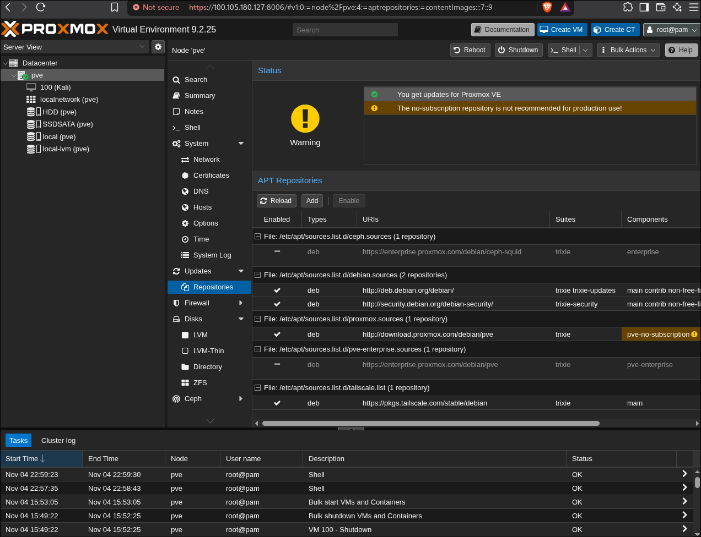

- Création des bridges `vmbr1`, `vmbr2` et `vmbr3`, puis *Apply Configuration*

  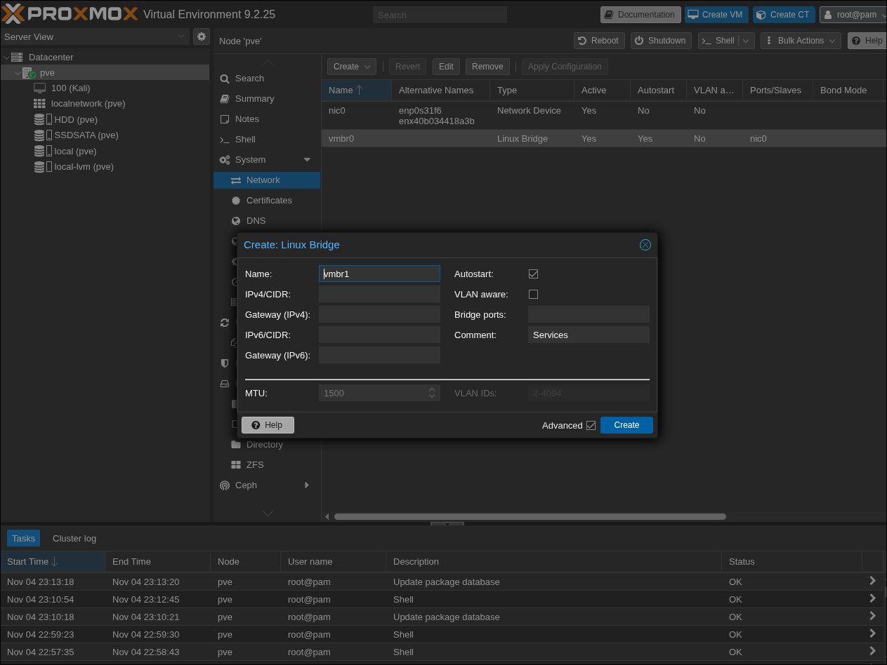
  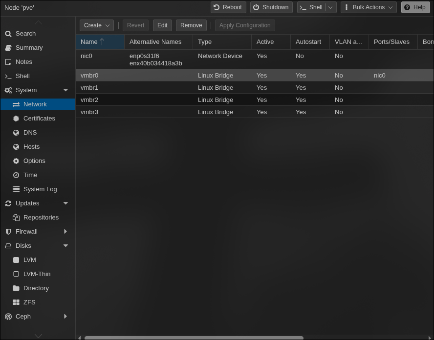

- Ajout de `vmbr4` puis de `vmbr5`, avec un commentaire par zone

  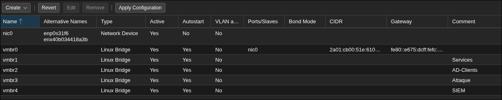
  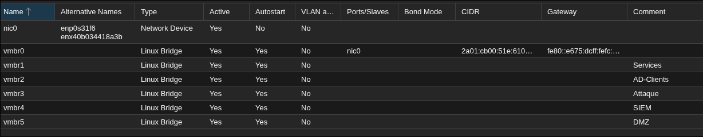

> **Incident :** une première VM 100 ne répondait plus à l'arrêt (`VM quit/powerdown failed - got timeout`, voir `screenshots/01-erreur-reboot-vm100.png`). Elle a été détruite puis recréée proprement.

---

## 4. Récupération de l'ISO OPNsense

L'image est distribuée en `OPNsense-26.7-dvd-amd64.iso.bz2`.

**Attention :** ce **n'est pas une archive tar**, `tar -xf` ne fonctionne pas. C'est un seul fichier compressé en bzip2 :

```bash
bunzip2 -k OPNsense-26.7-dvd-amd64.iso.bz2   # -k garde le .bz2 d'origine
```

Envoi ensuite dans Proxmox : `local` → *ISO Images* → *Upload*.

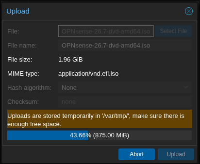

---

## 5. Création de la VM 100 (OPNsensefw)

| Paramètre        | Valeur                          | Pourquoi |
|------------------|---------------------------------|----------|
| Guest OS         | **Other**                       | OPNsense tourne sur FreeBSD, pas sur Linux |
| BIOS / Machine   | SeaBIOS / i440fx (par défaut)   | Suffisant pour OPNsense |
| Disque           | 32 Go, VirtIO SCSI single, local-lvm | Marge pour les logs et les plugins |
| CPU              | 1 socket, 2 cores, type **host** | Meilleures performances |
| RAM              | 2048 Mo, ballooning désactivé   | La RAM d'un pare-feu doit rester fixe |
| Démarrage auto   | Oui                             | Le pare-feu doit démarrer avec le nœud |

Captures : `09` à `13` dans `screenshots/`.

### Interfaces réseau

L'assistant de création n'ajoute qu'une seule carte réseau. Les autres s'ajoutent ensuite dans *Hardware → Add → Network Device*, **VM éteinte**. Toutes sont en **VirtIO**, avec le pare-feu Proxmox **décoché** (c'est OPNsense qui filtre).

`net4` et `net5` ont été ajoutées après l'installation, quand on est passé de trois à cinq zones internes. L'ISO a été retirée au même moment (*CD/DVD → Do not use any media*), sinon la VM redémarre sur l'installeur.

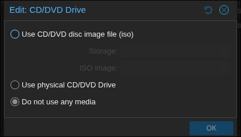
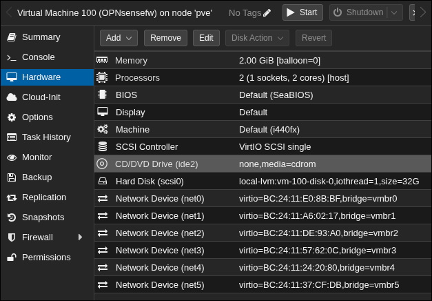

---

## 6. Installation d'OPNsense

1. Démarrer la VM et ouvrir la **Console**.
2. Se connecter avec `installer` / `opnsense`. **Attention :** la console est en QWERTY : sur un clavier AZERTY, le `a` de `installer` se tape avec la touche **Q**.
3. Keymap : French.
4. Système de fichiers : **UFS**. ZFS consomme beaucoup de RAM et n'apporte rien sur un seul disque virtuel, les snapshots étant déjà gérés par Proxmox.
5. Swap : environ la taille de la RAM, soit 2 Go.
6. Installation sur `da0`.

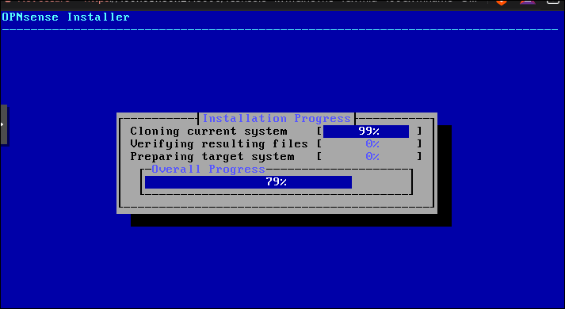
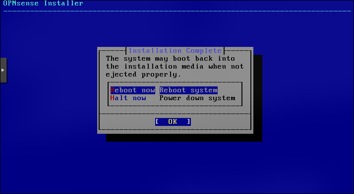

---

## 7. Association des interfaces (console, option 1)

Proxmox appelle les cartes `net0`…`net5`, OPNsense les appelle `vtnet0`…`vtnet5` (`vtnet` est le nom du pilote VirtIO sous FreeBSD). Les numéros se suivent en général, mais **rien ne le garantit** : le seul identifiant fiable des deux côtés est l'**adresse MAC**.

```
Zone → bridge (vmbrX) → carte Proxmox (netX) → MAC → vtnetX dans OPNsense
```

LAGG et VLAN : **non**. Le LAGG regroupe plusieurs liens physiques et le VLAN fait passer plusieurs réseaux sur un seul lien. Ici, chaque zone a son propre bridge et sa propre carte.

| OPNsense | vtnet  | MAC               | Proxmox | Bridge | Zone       |
|----------|--------|-------------------|---------|--------|------------|
| WAN      | vtnet0 | bc:24:11:e0:8b:bf | net0    | vmbr0  | WAN        |
| LAN      | vtnet4 | bc:24:11:24:20:80 | net4    | vmbr4  | SIEM       |
| OPT1     | vtnet1 | bc:24:11:a6:02:17 | net1    | vmbr1  | Services   |
| OPT2     | vtnet2 | bc:24:11:de:93:a0 | net2    | vmbr2  | AD-Clients |
| OPT3     | vtnet3 | bc:24:11:57:62:0c | net3    | vmbr3  | Attaque    |
| OPT4     | vtnet5 | bc:24:11:37:cf:db | net5    | vmbr5  | DMZ        |

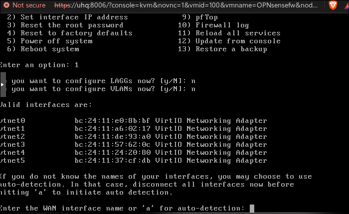
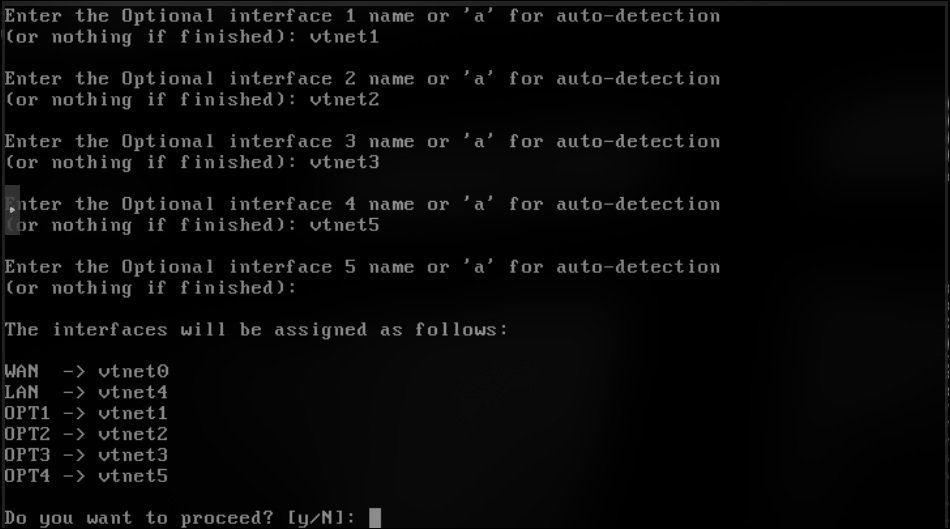

> **Incident :** lors des deux premiers essais, un appui sur *Entrée* est tombé sur les questions LAN puis Optional 1. Pour OPNsense, une réponse vide veut dire « terminé » : seul le WAN, puis seulement WAN et LAN, étaient associés (captures `28` et `29`). Réponse `N` à la confirmation, puis association refaite.

### Rôles WAN / LAN / OPT

| Type | Comportement par défaut |
|------|-------------------------|
| WAN  | Bloque tout le trafic entrant, fait le NAT sortant, IP reçue par DHCP |
| LAN  | Zone de confiance : sortie autorisée, serveur DHCP, règle anti-lockout pour l'interface web |
| OPT  | Aucune IP ni règle : tout est bloqué tant qu'on ne configure rien |

---

## 8. IP du LAN (console, option 2)

| Question | Réponse | Pourquoi |
|----------|---------|----------|
| IP du LAN par DHCP | Non | Le pare-feu a une IP fixe |
| IPv4 / masque | `10.10.10.1` / `24` | |
| Passerelle | aucune | OPNsense **est** la passerelle de la zone |
| IPv6 via WAN tracking | Non | |
| IPv6 via DHCP6 | Voir la correction ci-dessous | |
| Serveur DHCP sur le LAN | Oui, `10.10.10.100` à `10.10.10.200` | |
| Passer l'interface web en HTTP | Non | Rester en HTTPS : en HTTP, le mot de passe root circulerait en clair |
| Nouveau certificat auto-signé | Non | Celui généré à l'installation suffit |

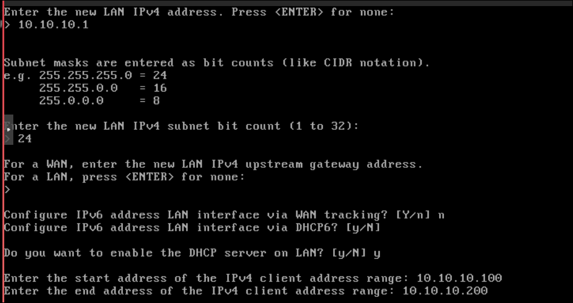

> **Erreur (corrigée en section 11) :** la réponse à « IPv6 via DHCP6 » était `y`. Ça demande au LAN d'obtenir son IPv6 comme **client** auprès d'un serveur DHCPv6, alors que dans la zone SIEM c'est OPNsense lui-même le serveur. Ça ne casse rien, mais c'est incohérent.

Ne pas confondre avec le **serveur** DHCP du LAN : là, OPNsense distribue les adresses aux VM de la zone.

Le mot de passe root par défaut (`opnsense`) a été changé avec l'option 3 de la console.

---

## 9. Accès à l'interface web (tunnel SSH)

L'interface web n'écoute que sur le LAN (`10.10.10.1`, dans `vmbr4`), et ce bridge n'a pas de port physique : depuis le PC, ce réseau n'existe pas. On passe donc par l'hôte Proxmox, qui sert de bastion.

1. Donner une IP à l'hôte Proxmox dans la zone SIEM : *pve → System → Network → vmbr4 → Edit*, IPv4/CIDR `10.10.10.2/24`, **sans passerelle** (l'hôte a déjà la sienne via `vmbr0`).

   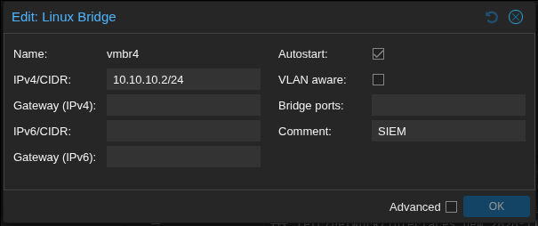

2. Vérifier depuis le Shell de l'hôte :

   ```bash
   ip -4 addr show vmbr4          # doit afficher inet 10.10.10.2/24
   ping -c 3 10.10.10.1           # doit répondre
   sysctl net.ipv4.ip_forward     # doit valoir 0
   ```

   `ip_forward = 0` est important : si l'hôte routait lui-même entre le réseau maison et le lab, il **contournerait OPNsense**.

3. Ouvrir le tunnel depuis le PC, puis aller sur `https://localhost:8443` :

   ```bash
   ssh -L 8443:10.10.10.1:443 root@uhq
   ```

   Aucune règle n'est ouverte sur le WAN : la seule porte d'entrée reste le SSH de Proxmox.

### Depuis l'extérieur (Tailscale)

L'hôte Proxmox est dans un tailnet Tailscale. Hors de chez moi, le même tunnel passe simplement par son nom Tailscale, toujours **depuis le PC** :

```bash
ssh -L 8443:10.10.10.1:443 root@pve
```

Proxmox reste joignable sur `https://pve:8006`. Rien n'est exposé sur Internet : ni ports ouverts sur la box ni règle sur le WAN d'OPNsense.

À distance, deux choses à ne **pas** faire : modifier `vmbr0` (Tailscale passe par là, on perdrait l'accès) et changer l'IP du LAN d'OPNsense (le tunnel ne mènerait plus nulle part ; rattrapable par la console de la VM).

> **Incident :** après *Edit → OK*, le ping répondait `Network is unreachable` et `vmbr4` n'avait aucune IP (capture `33`). Proxmox écrit d'abord les changements dans `/etc/network/interfaces.new` ; seul **Apply Configuration** les recopie dans `/etc/network/interfaces` et les applique. `ifreload -a` seul ne suffit pas, car il relit l'ancien fichier.
>
> | Message de `ping` | Signification |
> |-------------------|---------------|
> | `Network is unreachable` | Pas de route locale : la config n'est pas appliquée |
> | `Destination Host Unreachable` | Route OK, mais personne ne répond (VM éteinte, mauvais bridge) |
> | 100 % packet loss | Les paquets partent, mais un pare-feu bloque |

---

## 10. Assistant de configuration (interface web)

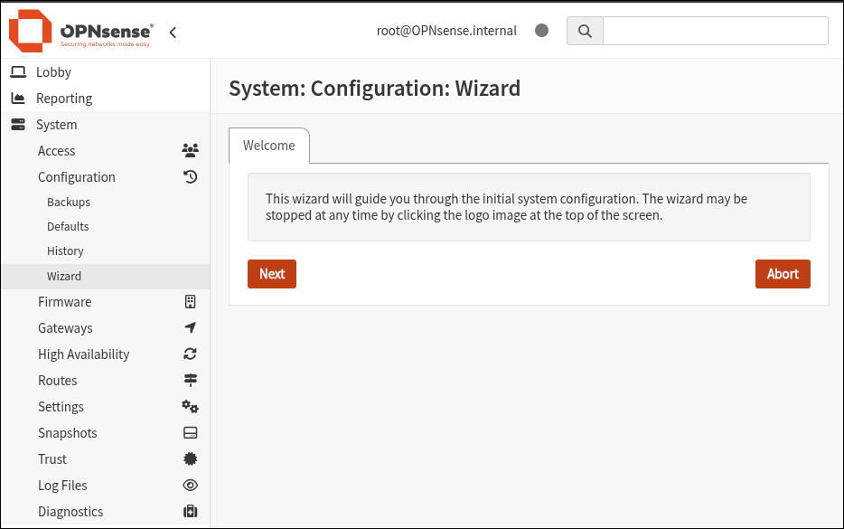

### General Information

| Champ | Valeur | Pourquoi |
|-------|--------|----------|
| Hostname | `fw01` | Un nom qui dit le rôle |
| Domain | `lab.internal` | Domaine de tout le lab. `.internal` est réservé aux réseaux privés depuis 2024 ; `.local` est à éviter (réservé au mDNS) |
| Timezone | `Europe/Paris` | Toutes les machines doivent avoir la même heure, sinon le SIEM ne peut pas reconstituer une chronologie d'attaque |
| DNS | `1.1.1.1`, `9.9.9.9` | DNS d'OPNsense lui-même |
| Override DNS | décoché | Ne pas laisser la box imposer ses DNS |
| Resolver (Unbound) | coché | Serveur DNS des VM |
| DNSSEC / Harden | coché / décoché | *Harden* peut casser certaines résolutions |

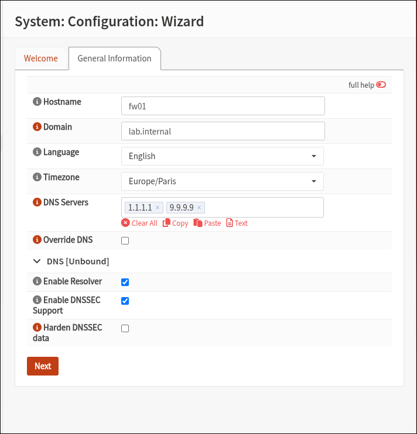

### Network [WAN]

| Champ | Valeur | Pourquoi |
|-------|--------|----------|
| Type | DHCP | IP reçue de la box |
| Block RFC1918 Private Networks | **décoché** | Le WAN est dans le réseau maison, lui-même en adresses privées (double NAT) |
| Block bogon networks | coché | Filtre les adresses qui ne devraient jamais exister sur Internet |

Même sans le blocage RFC1918, le filtrage **stateful** garantit qu'aucune connexion entrante non sollicitée n'est acceptée sans règle explicite. Les réponses aux connexions sortantes, elles, passent toujours.

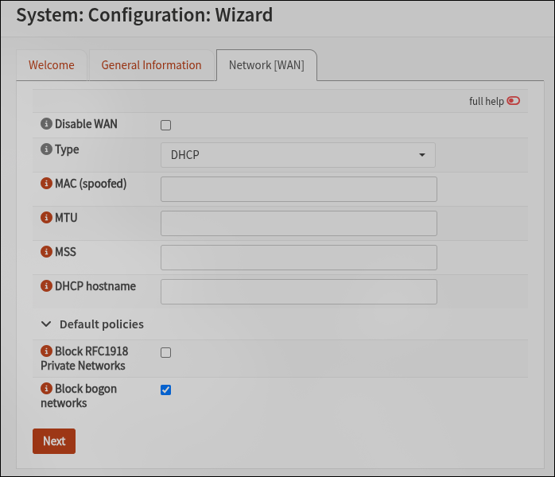

### Network [LAN]

IP conservée : `10.10.10.1/24`. La changer couperait le tunnel SSH.

### Deployment type

| Option | Choix | Pourquoi |
|--------|-------|----------|
| Optimize for Multiwan | décoché | Un seul accès Internet |
| Automatic DHCP/DNS registration | coché | Les VM sont joignables par leur nom (`kali.lab.internal`) |
| Optimize for IPsec | décoché | Pas de VPN site à site |

La capture montre les valeurs par défaut, avant le décochage de *Multiwan*.

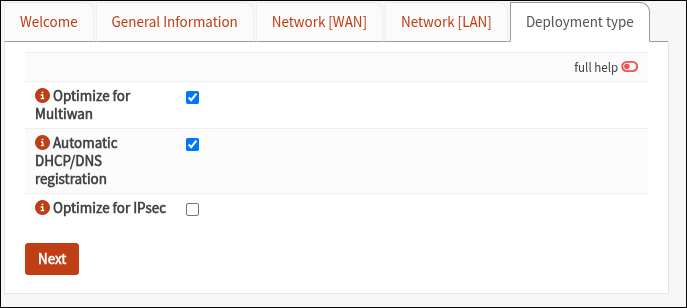

### Mot de passe root

Champs laissés vides : le mot de passe a déjà été changé en console, et c'est le même compte.

Puis **Apply** pour terminer l'assistant.

### Snapshot `post-wizard`

Avant de toucher aux zones et aux règles, un snapshot Proxmox de la VM 100 : *VM 100 → Snapshots → Take Snapshot*, nom `post-wizard`, **RAM incluse**. Si une mauvaise règle coupe l'accès, on revient à cet état en un clic, sans réinstaller.

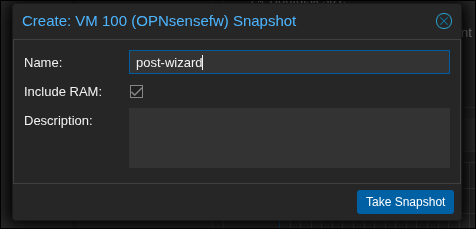

---

## 11. Correction de l'IPv6 du LAN

Correction de l'erreur notée en section 8 : *Interfaces → [LAN] → IPv6 Configuration Type : **None***, puis *Save* et *Apply*. Le LAN n'essaie plus d'obtenir une IPv6 comme client DHCPv6. Le lab reste en IPv4 uniquement, ce qui simplifie les règles de pare-feu (une seule famille d'adresses à filtrer).

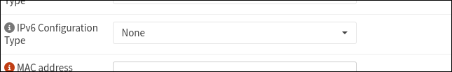

---

## 12. Configuration des zones OPT

Après l'association (section 7), les OPT existent mais sont désactivées, sans IP ni nom parlant. Pour chacune : *Interfaces → [OPTx]*.

| Champ | Valeur | Pourquoi |
|-------|--------|----------|
| Enable | coché | Sinon l'interface ne fait rien |
| Description | nom de la zone | C'est le nom affiché partout (règles, DHCP, logs) : `ATTAQUE` se lit mieux que `OPT3` |
| Block private networks | décoché | Ces zones **sont** des réseaux privés : cocher bloquerait tout leur trafic légitime |
| Block bogon networks | décoché | Option prévue pour un WAN, inutile sur une zone interne |
| IPv4 Configuration Type | Static IPv4 | OPNsense est la passerelle de la zone, son IP doit être fixe |
| IPv6 Configuration Type | None | Lab en IPv4 uniquement |
| IPv4 address | `10.10.X.1` / `24` | Toujours `.1`, comme pour le LAN |
| IPv4 gateway rules | Disabled | **Aucune passerelle sur une interface interne** : sinon OPNsense la traiterait comme une sortie vers Internet (comme un WAN) et ajouterait du NAT et du *reply-to* |

| Interface | vtnet | Description | IP |
|-----------|-------|-------------|----|
| OPT1 | vtnet1 | `SERVICES` | `10.10.40.1/24` |
| OPT2 | vtnet2 | `AD_CLIENTS` | `10.10.50.1/24` |
| OPT3 | vtnet3 | `ATTAQUE` | `10.10.20.1/24` |
| OPT4 | vtnet5 | `DMZ` | `10.10.30.1/24` |

*Save*, puis **Apply changes** en haut de la page : sans ce clic, la configuration est enregistrée mais pas appliquée.

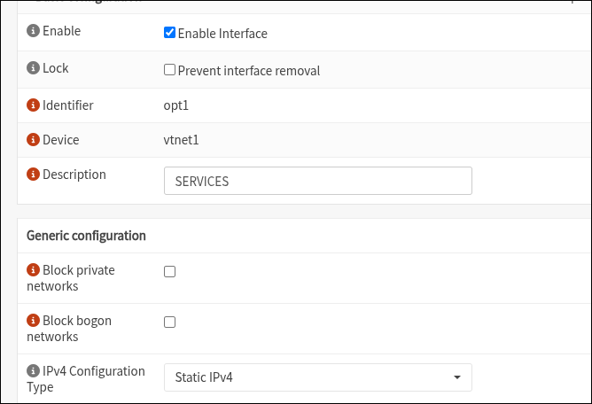
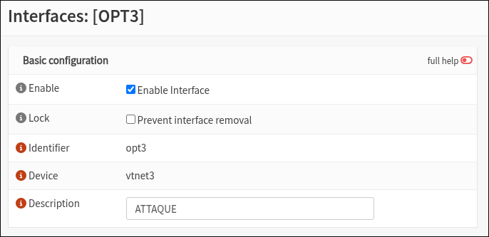
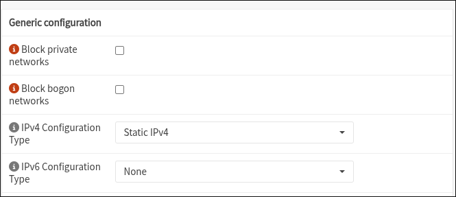
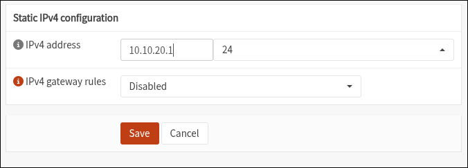

### Vérification

*Interfaces → Overview* : les six interfaces sont *up* et chacune a son IP en `.1`. Le WAN a reçu `192.168.1.x` de la box par DHCP (plus une IPv6 publique, inutilisée par le lab). Le LAN n'a qu'une IPv6 *link-local* (`fe80::`), ce qui confirme que la correction de la section 11 a bien été appliquée.

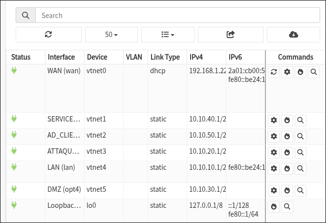

Une fois activée, une OPT **bloque toujours tout** : contrairement au LAN, elle n'a aucune règle par défaut. Les VM de la zone n'iront nulle part tant que les règles de pare-feu ne sont pas écrites.

---

## 13. Prochaines étapes (TODO)

### OPNsense
- [x] Retirer l'ISO et ajouter `net4` / `net5`
- [x] Associer les interfaces (WAN, LAN et 4 OPT)
- [x] IP du LAN et serveur DHCP du LAN
- [x] Changer le mot de passe root
- [x] Accéder à l'interface web (tunnel SSH par l'hôte Proxmox)
- [x] Terminer l'assistant (*Apply*) et snapshot `post-wizard`
- [x] LAN : IPv6 Configuration Type → **None**
- [x] Activer, renommer et adresser les OPT (`SERVICES`, `AD_CLIENTS`, `ATTAQUE`, `DMZ`)
- [x] Vérifier dans *Interfaces → Overview* que les 4 OPT sont *up* avec leur IP
- [ ] Activer un serveur DHCP par zone (le DNS d'AD-Clients doit pointer vers le DC)
- [ ] Règles de pare-feu entre les zones
- [ ] Snapshot Proxmox de la VM « propre »

### VM du lab
- [ ] Kali (zone Attaque)
- [ ] Debian + Docker avec DVWA, bWAPP, Juice Shop (DMZ)
- [ ] Wazuh (zone SIEM)
- [ ] Windows Server 2022 en contrôleur de domaine (Services)
- [ ] Client Windows joint au domaine (AD-Clients)
- [ ] Sysmon et agent Wazuh sur les machines Windows
