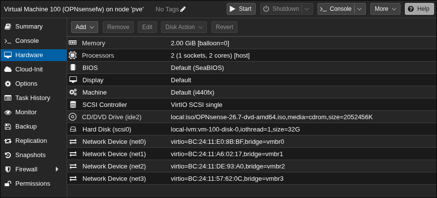

# Lab Proxmox + OPNsense

Journal de bord du lab : un nœud Proxmox VE avec une VM pare-feu OPNsense qui route et filtre plusieurs réseaux internes.

> **État au 05/11/2026 :** OPNsense 26.7 est installé sur la VM 100. L'association des interfaces et la configuration réseau restent à faire.

---

## 1. Architecture

```
                 Internet / box
                       │
                    [ nic0 ]
                       │
                  ┌─ vmbr0 ─┐  (WAN, bridge sur la carte physique)
                  │         │
                  │  VM 100 │  OPNsense (OPNsensefw)
                  │         │
        ┌─────────┼─────────┼─────────┐
      vmbr1     vmbr2     vmbr3
      (LAN)     (OPT1)    (OPT2)      ← bridges internes, sans port physique
```

`vmbr1`, `vmbr2` et `vmbr3` n'ont aucun port physique : ce sont des réseaux isolés. Les VM qui y sont branchées ne peuvent joindre l'extérieur, ou les autres réseaux, qu'en passant par OPNsense.

| Bridge | Port physique | Rôle prévu |
|--------|---------------|------------|
| vmbr0  | nic0          | WAN        |
| vmbr1  | aucun         | LAN        |
| vmbr2  | aucun         | OPT1       |
| vmbr3  | aucun         | OPT2       |

---

## 2. Préparation du nœud Proxmox

- Correction des dépôts APT (sans abonnement)

  

- Création des bridges `vmbr1`, `vmbr2` et `vmbr3`, puis *Apply Configuration*

  
  

> **Incident :** une première VM 100 ne répondait plus à l'arrêt (`VM quit/powerdown failed - got timeout`, voir `screenshots/01-erreur-reboot-vm100.png`). Elle a été détruite puis recréée proprement.

---

## 3. Récupération de l'ISO OPNsense

L'image est distribuée en `OPNsense-26.7-dvd-amd64.iso.bz2`.

**Attention :** ce **n'est pas une archive tar**, `tar -xf` ne fonctionne pas. C'est un seul fichier compressé en bzip2 :

```bash
bunzip2 -k OPNsense-26.7-dvd-amd64.iso.bz2   # -k garde le .bz2 d'origine
```

Envoi ensuite dans Proxmox : `local` → *ISO Images* → *Upload*.


---

## 4. Création de la VM 100 (OPNsensefw)

| Paramètre        | Valeur                          | Pourquoi |
|------------------|---------------------------------|----------|
| Guest OS         | **Other**                       | OPNsense tourne sur FreeBSD, pas sur Linux |
| BIOS / Machine   | SeaBIOS / i440fx (par défaut)   | Suffisant pour OPNsense |
| Disque           | 32 Go, VirtIO SCSI single, local-lvm | Marge pour les logs et les plugins |
| CPU              | 1 socket, 2 cores, type **host** | Meilleures performances |
| RAM              | 2048 Mo, ballooning désactivé   | La RAM d'un pare-feu doit rester fixe |
| Démarrage auto   | Oui                             | Le pare-feu doit démarrer avec le nœud |

Captures : `09` à `13` dans `screenshots/`.

### Interfaces réseau

L'assistant de création n'ajoute qu'une seule carte réseau. Les autres s'ajoutent ensuite dans *Hardware → Add → Network Device*, **avant le premier démarrage**. Toutes sont en **VirtIO**, avec le pare-feu Proxmox **décoché** (c'est OPNsense qui filtre).

| Proxmox | Bridge | Nom dans OPNsense | Rôle |
|---------|--------|-------------------|------|
| net0    | vmbr0  | vtnet0            | WAN  |
| net1    | vmbr1  | vtnet1            | LAN  |
| net2    | vmbr2  | vtnet2            | OPT1 |
| net3    | vmbr3  | vtnet3            | OPT2 |



---

## 5. Installation d'OPNsense

1. Démarrer la VM et ouvrir la **Console**.
2. Se connecter avec `installer` / `opnsense`. **Attention :** la console est en QWERTY : sur un clavier AZERTY, le `a` de `installer` se tape avec la touche **Q**.
3. Keymap : French.
4. Système de fichiers : **UFS**. ZFS consomme beaucoup de RAM et n'apporte rien sur un seul disque virtuel, les snapshots étant déjà gérés par Proxmox.
5. Swap : environ la taille de la RAM, soit 2 Go.
6. Installation sur `da0`.


---

## 6. Prochaines étapes (TODO)

- [ ] *Halt now*, puis retirer l'ISO (CD/DVD → *Do not use any media*)
- [ ] Démarrer la VM et se connecter en `root` / `opnsense` (mot de passe par défaut)
- [ ] Option 1 du menu console : associer les interfaces (WAN = vtnet0, LAN = vtnet1, OPT1 = vtnet2, OPT2 = vtnet3)
- [ ] Option 2 : adresses IP du LAN et des OPT
- [ ] Changer le mot de passe root
- [ ] Accéder à l'interface web depuis le LAN
- [ ] Faire un snapshot Proxmox de la VM « propre »
